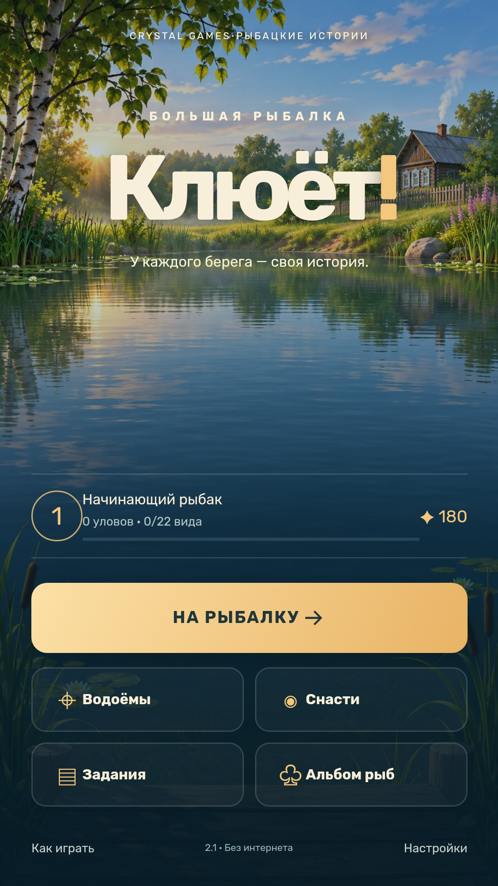

# Рыбалка: Клюёт! 2.1.0 — Android APK

Скачать: [fishing-2.1.0.apk](https://github.com/ff3f1/crystal-games/raw/refs/heads/builds-fishing2-2.1/fishing-2.1.0.apk)

Пакет: `ru.crystalgames.fishing2`, версия `2.1.0`, код `210`.
Подписан тем же ключом Crystal Games, что и 2.0.1. Обновление сохраняет локальный
прогресс 2.0.1. Основное приложение `ru.crystalgames.fishing` устанавливается отдельно.

- Главное меню с продолжением рыбалки, настройки, пауза и дневник.
- 6 локаций: пруд, река, море; летние и зимние варианты.
- 22 вида с местными таблицами клёва, альбомом и рекордами.
- Выбор наживки и точки, двухфазная поклёвка, подсечка и вываживание.
- Улучшения снастей, опыт и 14 заданий с наградами.
- 2 оригинальные музыкальные темы, 4 звуковых пейзажа, 10 эффектов.
- Без рекламы, платежей, сетевых загрузок и выделения текста на кнопках.

Все ресурсы включены в APK. Для старого системного WebView предусмотрен
совместимый режим отрисовки.

Проверки: полный цикл рыбалки на 6 картах в Chromium; покупки, задания,
сохранение, настройки звука и пауза. Установка и проверка меню/управления
в эмуляторе Android с отключённой сетью. На физическом телефоне автором
сборки пока не проверено.

Исходники: ветка `codex/fishing2-complete` в этом репозитории.

Сборка и Android-проверка: https://github.com/ff3f1/crystal-games/actions/runs/44114650999

Исходный коммит: `ccac2fe4b4d4b666790682477eefb96036df6e13`.

